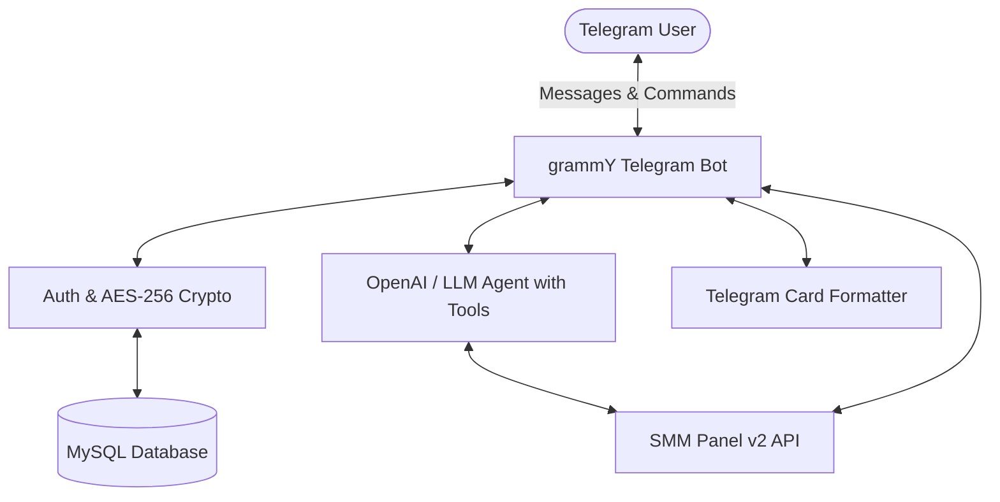

# 🤖 Panel Chat Bot

[](LICENSE)
[](https://nodejs.org/)
[](https://grammy.dev/)
[](https://platform.openai.com/)
[](https://github.com/grownex-ventures/panel-chat-bot/actions)

An intelligent, open-source AI Telegram bot for SMM (Social Media Marketing) panels. Built on the standard **SMM v2 API protocol**, it allows users to discover services, check live balances, place orders, track status, and request refills using natural language chat or instant slash commands.

---

## ✨ Features

- 🧠 **Conversational AI Agent**: Powered by OpenAI-compatible models (OpenAI, NVIDIA NIM, OpenRouter, Groq, Ollama) with autonomous tool calling.
- 📱 **Mobile-Optimized Formatting**: Custom layout engine transforms complex pricing and search data into clean, aligned card blocks with medal ranks (🥇, 🥈, 🥉), attribute badges, and single-tap copy commands. Strictly avoids broken Markdown pipe tables.
- 🔐 **Bank-Grade Security**:
  - **AES-256-GCM** authenticated encryption for stored API keys.
  - Deterministic **SHA-256** hashing prevents multiple accounts using duplicate keys.
  - Automatic session takeover prevention with instant revocation alerts.
  - Strict input guardrails and rate-limiting to prevent spam and exploits.
- ⚡ **Direct Slash Commands**:
  - `/balance` — Check wallet balance and currency instantly.
  - `/services [keyword]` — Filter services by keyword with rate and limits.
  - `/order <service_id> <quantity> <link>` — Place an instant order.
  - `/status <order_id>` — Track order progress, start count, and remaining items.
  - `/refill <order_id>` — Submit an automated refill request.
  - `/cancel <order_id>` — Cancel pending or in-progress orders.
  - `/help` — View available commands and usage guide.
  - `/logout` — End active session and purge credentials safely.
- 🗄️ **Production-Ready Database**: MySQL schema with connection pooling, keep-alive pings, indexed session tokens, and foreign key cascades.
- 🐳 **Docker & CI/CD**: Includes Dockerfile, docker-compose configuration, and GitHub Actions continuous integration workflow.
- 🧪 **Comprehensive Test Suite**: Automated unit and security tests using Node's native test runner (`node --test`).

---

## 🏗️ Architecture



---

## 📋 Prerequisites

- **Node.js** >= 20.0.0
- **MySQL** 8.0+ or **MariaDB** 10.5+
- **Telegram Bot Token** (Create one via [@BotFather](https://t.me/BotFather))
- **LLM API Key** (OpenAI, NVIDIA NIM, Groq, OpenRouter, etc.)
- **SMM Panel API Key** (from any SMM panel supporting v2 API)

---

## 🚀 Quick Start

### 1. Clone the Repository

```bash
git clone https://github.com/grownex-ventures/panel-chat-bot.git
cd panel-chat-bot
```

### 2. Install Dependencies

```bash
npm install
```

### 3. Generate Encryption Key & Configure Environment

Generate a secure 32-byte (64 hex characters) encryption key:

```bash
node -e "console.log(require('crypto').randomBytes(32).toString('hex'))"
```

Copy the example configuration:

```bash
cp .env.example .env
```

Edit `.env` and fill in your details:

```env
# Telegram Bot
BOT_TOKEN=your_telegram_bot_token_here

# SMM Panel API v2 Endpoint
PROVIDER_BASE_URL=https://your-panel.com/api/v2

# MySQL Database
DB_HOST=localhost
DB_USER=root
DB_PASSWORD=your_mysql_password
DB_NAME=provider_bot

# AI / LLM Configuration (OpenAI Compatible)
LLM_BASE_URL=https://api.openai.com/v1
LLM_API_KEY=your_llm_api_key
LLM_MODEL=gpt-4o-mini

# AES-256 Encryption Key (64 hex characters generated above)
ENCRYPTION_KEY=your_64_character_hex_key_here
```

### 4. Initialize Database

Execute the schema in MySQL:

```bash
mysql -u root -p provider_bot < sql/schema.sql
```

### 5. Run the Bot

**Development Mode (with auto-reload):**
```bash
npm run dev
```

**Production Mode:**
```bash
npm start
```

---

## 🐳 Docker Deployment

You can deploy the complete stack (Bot + MySQL) with a single command:

```bash
docker compose up -d --build
```

View logs:
```bash
docker compose logs -f bot
```

---

## 🧪 Testing

Run the automated test suite:

```bash
npm test
```

Tests cover:
- AES-256-GCM encryption/decryption roundtrips and tamper protection
- SHA-256 key hashing
- Input sanitization and HTML entity escaping
- Telegram card formatting and Markdown table transformation
- Guardrails and rate-limiting cooldown enforcement
- SMM API client error handling

---

## 🔐 Security Best Practices

- **Never commit `.env`**: `.gitignore` strictly blocks all environment files, secrets, logs, and dumps.
- **Short-Lived Sessions**: Sessions are tracked via cryptographically random 64-character tokens.
- **Tamper Resistance**: AES-256 in Galois/Counter Mode (GCM) ensures any ciphertext modification fails validation.

---

## 🤝 Contributing

Contributions are welcome! Please feel free to submit a Pull Request.

1. Fork the Project
2. Create your Feature Branch (`git checkout -b feat/amazing-feature`)
3. Commit your Changes (`git commit -m 'feat: add amazing feature'`)
4. Push to the Branch (`git push origin feat/amazing-feature`)
5. Open a Pull Request

---

## 📄 License

Distributed under the **MIT License**. See [`LICENSE`](LICENSE) for more information.

---

## 💬 Community & Support

Built with ❤️ by **[Grownex Ventures](https://github.com/grownex-ventures)**.
For inquiries or assistance, open an issue on GitHub.
